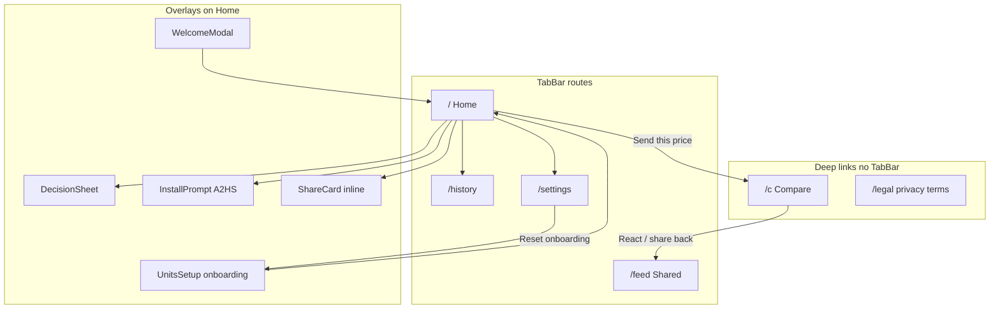

# Screen Flows & Scenarios

Screen-centric map of RealCost — every route and overlay, what it’s for, how people get in and out, what can go wrong, and where to improve next.

**Companion to:** [05 — User Journeys](./05-user-journeys.md) (narrative end-to-end paths).  
**Use with:** [12 — QA Checklist](./12-qa-checklist.md) (pass/fail) · [11 — Analytics](./11-analytics.md) (event names).

**Live:** [https://realcost-xi.vercel.app/](https://realcost-xi.vercel.app/)

**Audience:** founder / UX / eng deciding where to cut friction.

---

## Context / Problem

RealCost wins in **moments**, not daily dashboards. Drop-offs hide in empty states, secondary CTAs, and edge paths (`/c` wage entry, Exact mode, Shared inbox discovery).

End-to-end journeys in `05` answer *what loop are we proving?* This doc answers *what happens on each screen, in which state, and what should we fix first?*

Rules of thumb:

- One job per screen (or overlay)
- Every extra step before the first **hours** reveal costs hypothesis validation
- Wage never leaves the device via URL, analytics, or share metadata

---

## Approach

### How to read each screen section

| Field | Meaning |
|-------|---------|
| **Job** | One-sentence job to be done |
| **Primary / secondary** | Main CTA vs supporting actions |
| **Entry / exit** | How users arrive and leave |
| **States** | Empty · default · success · error · reduced-motion |
| **Scenarios** | Short stories (happy / alternate / failure) |
| **Analytics** | Privacy-safe events only (no wage/rate/name props) |
| **Friction → improve** | Specific opportunities, not “make nicer” |

### Information architecture

| Surface | Route / component | TabBar? |
|---------|-------------------|---------|
| Onboarding | `UnitsSetup` on `/` when no units | No |
| Welcome | `WelcomeModal` once after setup | Under Home |
| Home | `/` | Yes |
| ShareCard | Nested on Home / Shared / `/c` | — |
| Shared | `/feed` | Yes |
| History | `/history` | Yes |
| Settings | `/settings` | Yes |
| Compare | `/c` | **No** |
| Legal | `/legal/privacy`, `/legal/terms` | No |
| Install | `InstallPrompt` peak-gated | Overlay |

---

## Artifacts — Per-screen catalog

### 1. Onboarding (`UnitsSetup`)

**Job:** Capture a private take-home baseline + local personalization so Home can show *their* hours.

**Primary action:** Complete 3 steps → **Open RealCost**  
**Secondary:** Back between steps; wage range chips vs Custom exact

**Entry:** Fresh install / cleared units / Settings → Reset onboarding  
**Exit:** `onDone(units)` → Home (+ welcome if first time)

| State | Behavior |
|-------|----------|
| Step 0 intro | Brand + `OnboardingCostPreview` digit reels; **See it differently** |
| Step 1 wage | Range chips (`$15–20` … `$35+` / Custom) → midpoint or typed rate |
| Step 2 personalize | Focus chips + tone (5 incl. Deadpan) + required name |
| Blocked continue | Empty wage / incomplete personalize disables primary |
| Reduced motion | Preview reels snap |

**Scenarios**

- **Happy:** Intro → `$20–25` chip → Continue → Gently + name → Open → Home
- **Alternate:** Custom exact `$28.50` → Hyped → Open
- **Failure:** User stalls on wage (feels like signup) — only preview on step 0 softens this
- **Return:** Reset onboarding re-enters setup; history/comparisons preserved

**Analytics:** `onboarding_completed` (`tone`, `focus` / spending focus — never wage)

**Friction → improve**

| Friction | Opportunity |
|----------|-------------|
| 3 steps before first real price | Consider collapsing personalize after first calc (soft gate) |
| Midpoint ≠ true rate | Stronger Settings “edit exact rate” cue after first share |
| Name required | Make name optional to shorten door (privacy story still holds) |
| Five tones | Default Gently; surface Deadpan as “meme voice” only after first decision |

---

### 2. Welcome modal (`WelcomeModal`)

**Job:** One-time orientation: price → hours → share without wage.

**Primary:** **Try your first price** (dismiss)  
**Secondary:** Esc / backdrop click dismiss

**Entry:** First Home after setup when welcome not seen  
**Exit:** Focus returns to price field; `markWelcomeSeen()`

| State | Behavior |
|-------|----------|
| Default | Greeting with optional name; 3 privacy bullets |
| Reduced motion | Sheet still usable; no dependency on motion |

**Scenarios**

- **Happy:** Read → Try first price → type amount
- **Alternate:** Esc immediately — still valid; don’t re-show
- **Failure:** Modal blocks calc — keep copy short (already)

**Analytics:** none (local welcome flag only)

**Friction → improve**

| Friction | Opportunity |
|----------|-------------|
| Modal before first number | Optional: skip if user already typed price underneath |
| Three bullets | Could be one line + link to Privacy |

---

### 3. Home (`/`)

**Job:** Turn a price into hours, optionally log a decision, and start a share.

**Primary:** Enter price → see hours; **Send this price**  
**Secondary:** Category chips; Bought / Thinking / Skipped; ShareCard save image/video; streak / hours-kept share

**Entry:** TabBar Home; post-onboarding; “Try your own price” from `/c`  
**Exit:** Share sheet / clipboard; other tabs; DecisionSheet dismiss

| State | Behavior |
|-------|----------|
| Empty price | No result stack |
| Live result | Digit reels + life-span gloss ≥24h; category + decisions + ShareCard |
| Decision locked | Choice committed; change in History; secondary UI collapses |
| Streak | Weekly paused hours + flame when streak > 0 |
| Reduced motion | Reels snap; haptics off |

**Scenarios**

- **Happy:** `$150` → ~hours → Food → Skipped → sheet → Send (Private link)
- **Alternate:** Calc only, never decide — still can share (hypothesis-friendly)
- **Alternate:** Meaningful Skipped (≥1h) arms A2HS peak
- **Failure:** Absurd paste → clamped / compact format, no Infinity
- **Failure:** Native share cancel → must **not** show “copied” success

**Analytics:** `calculation_created`, `category_selected`, `decision_*`, `share_started`, `share_completed`, `share_image_*`, `share_video_*`

**Friction → improve**

| Friction | Opportunity |
|----------|-------------|
| Reveal stack density (category + decide + card) | Progressive disclosure: Share first, decide secondary |
| Send buried after decide lock | Keep Send sticky / always visible after first hours |
| Life-span gloss competes with hours | Keep muted; never replace hours |
| No “clear price” affordance | Explicit reset for next purchase moment |

---

### 4. ShareCard (nested surface)

**Job:** Produce a screenshot-/share-ready object: hours lead, never wage.

**Primary:** **Save / share image**  
**Secondary:** **Save / share video** (standard Post/Story only); format Post ↔ Story

**Entry:** Home after result; Shared challenge unlock; `/c` “Save dual card”; hours-kept from streak  
**Exit:** Native file share or download

| State | Behavior |
|-------|----------|
| Standard | Poster 4:5 or Story 9:16; hours hero |
| Challenge dual | Both hours; no Post/Story toggle |
| Hours kept | “Kept this week” variant |
| Video unavailable | Dual / hoursKept / reduced-motion / no MediaRecorder → PNG only |
| Recording | “Recording…” then share/download WebM (or MP4 if supported) |

**Scenarios**

- **Happy:** Story format → Save image → Instagram Stories
- **Happy:** Save video → reel settles 0 → hours (~3.5s)
- **Alternate:** Reduced motion → video CTA hidden; PNG path
- **Failure:** Recorder fails → silent PNG fallback (still `share_video_*` if user initiated video — treat completion carefully in QA)

**Analytics:** `share_image_started` / `completed`, `share_video_started` / `completed` (`challenge`, `format`, `variant` only)

**Friction → improve**

| Friction | Opportunity |
|----------|-------------|
| Two CTAs (image + video) | Single “Share card” sheet: Image \| Video |
| Video only on standard cards | Later: subtle dual-card motion (no wage) |
| Filename generic | Include price label in filename for camera roll findability |

---

### 5. Shared (`/feed`)

**Job:** Local inbox for sent challenges and received comparisons — proof the loop moved.

**Primary:** Open / inspect entries; unlock dual card when both hours exist  
**Secondary:** Pagination; honesty banner dismiss; empty-state nudge to Home

**Entry:** TabBar Shared; post-share; reaction applied on device  
**Exit:** Home to send more; Settings

| State | Behavior |
|-------|----------|
| Empty overall | Tone-aware empty copy |
| Waiting | Sent, not seen |
| Seen / replied | Sent + `seenAt` |
| Received | Inbound comparisons |
| Section empty | Per-section hints (“Challenge a friend from Home”) |

**Scenarios**

- **Happy:** Send → Waiting → friend reacts → Seen + dual unlock
- **Alternate:** Receive `/c` → complete → appears under Received
- **Failure:** Reaction on device without original `shareId` → honesty / soft message (no server)
- **Failure:** User never opens Shared — loop invisible

**Analytics:** `comparison_updated`, `reaction_received` (when applied)

**Friction → improve**

| Friction | Opportunity |
|----------|-------------|
| Tab label “Shared” vs mental model “Challenges” | Rename / tooltip: “Your challenges” |
| Waiting feels dead | Soft copy: “Waiting for their hours” + re-share CTA |
| Dual unlock discovery | Auto-expand first unlock once |
| Empty sections clutter | Collapse empty sections by default |

---

### 6. History (`/history`)

**Job:** Review and revise logged decisions — not the viral loop, but retention / reflection.

**Primary:** Browse / filter entries  
**Secondary:** Edit choice or category; heat map lenses (kept / thinking / spent)

**Entry:** TabBar History; after DecisionSheet  
**Exit:** Home for next price

| State | Behavior |
|-------|----------|
| Empty | Tone-aware empty copy |
| Filtered | Decision + category filters; sort/date |
| Editing | Chip edit on entry |
| Heat map | Category heat lenses |

**Scenarios**

- **Happy:** Filter Skipped this week → adjust category
- **Alternate:** Change Bought → Thinking after regret
- **Failure:** Empty history after onboard — nudge first calc (already via empty copy)

**Analytics:** `decision_updated`, `decision_deleted`, `category_selected` (as applicable)

**Friction → improve**

| Friction | Opportunity |
|----------|-------------|
| History doesn’t push share | Optional “Share this price again” on row |
| Heat map advanced | Gate behind ≥5 decisions to avoid empty complexity |
| No search | Price search once log grows |

---

### 7. Settings (`/settings`)

**Job:** Adjust local rate, voice, look, and share privacy without leaving the device trust model.

**Primary:** Save dirty changes (rate, name, focus, tone, units)  
**Secondary:** Private ↔ Exact (confirm); theme/motion; reset onboarding; clear all; legal links

**Entry:** TabBar Settings  
**Exit:** Home; legal pages; reset → onboarding

| State | Behavior |
|-------|----------|
| Clean | Save disabled |
| Dirty | Save enabled when wage valid |
| Exact confirm | Dialog explains `p÷h` rate leak risk |
| Reset | Clears setup; **preserves** log + comparisons |
| Clear all | Wipes product data after confirm |

**Scenarios**

- **Happy:** Bucket midpoint → Settings exact `$23.40` → Save
- **Happy:** Switch tone to Deadpan → next DecisionSheet matches
- **Alternate:** Exact mode + confirm → shares include `h`
- **Failure:** Wage cleared → cannot save
- **Failure:** Accidental Exact — confirm dialog is the safety rail

**Analytics:** none required on save (local); avoid logging Exact as wage

**Friction → improve**

| Friction | Opportunity |
|----------|-------------|
| Exact risk abstract | Show example: “$150 at 6h ≈ $25/hr visible to anyone with the link” |
| Reset vs clear all | Stronger labeling: “Redo setup” vs “Erase everything” |
| Tone buried in accordion | Preview one sample line per tone on select |

---

### 8. Compare (`/c`)

**Job:** Let a recipient see what the shared price costs *them* — and optionally react/share back.

**Primary:** Enter rate → **See my hours**; then **React** / **Send this back**  
**Secondary:** Median benchmark teaser; adjust rate/name; Save dual card; Home link

**Entry:** Shared URL (`p`, optional `h` / `s` / `reply`)  
**Exit:** React link; new share; Home; Shared (on reply landing)

| State | Behavior |
|-------|----------|
| Invalid `p` | Broken-link copy → ask resend |
| Reply (`reply=1`) | Apply reaction on-device; banner → Open Shared |
| Pre-reveal | Price + peer hours if Exact; **US median (~$22/hr) teaser**; wage field |
| Revealed | HoursOdometer + optional peer; react / share; ShareCard |
| Reduced motion | Reels snap |

**Scenarios**

- **Happy (Private):** Open → see median teaser → enter rate → reveal → React
- **Happy (Exact):** See their hours + enter own → side-by-side story
- **Alternate:** Share back without `s` → new challenge link
- **Failure:** Bounce before wage — median teaser is the softener; still watch completion ratio
- **Failure:** Legacy `n=` in URL → stripped from address bar; ignored in decode

**Analytics:** `comparison_opened`, `recipient_calculation_completed`, `recipient_shared`, `reaction_sent`, `reaction_received`

**Privacy:** Recipient wage → `realcost:units` only. Median constant is display-only. **Never** new URL params for wage/benchmark.

**Friction → improve**

| Friction | Opportunity |
|----------|-------------|
| Wage field still cold | Wage range chips on `/c` (same midpoints; still local) |
| Benchmark vs peer confusion | If Exact peer hours present, label benchmark as “US median (not them)” |
| React requires share sheet | Copy reaction link as default on desktop |
| No TabBar | Footer: “Make your own RealCost” stronger |

---

### 9. Legal (`/legal/privacy`, `/legal/terms`)

**Job:** Trust documentation; explain Private vs Exact and localStorage.

**Primary:** Read / navigate back  
**Secondary:** Cross-links between privacy and terms

**Entry:** Settings footers; external  
**Exit:** Browser back / Settings

| State | Behavior |
|-------|----------|
| Static | `LegalShell` content |

**Scenarios**

- **Happy:** User checks Exact risk before enabling
- **Failure:** Legal unread — Exact confirm must still carry the risk story

**Analytics:** none

**Friction → improve**

| Friction | Opportunity |
|----------|-------------|
| Dense legal | In-app “What Private means” cheatsheet (3 bullets) before Exact toggle |

---

### 10. Install prompt (`InstallPrompt` A2HS)

**Job:** Soft home-screen install after an emotional peak (share or meaningful skip) — not cold open nag.

**Primary:** Install / Add to Home Screen  
**Secondary:** Dismiss

**Entry:** Peak flag after share success or meaningful Skipped; not already dismissed / standalone  
**Exit:** Installed, dismissed, or ignored

| State | Behavior |
|-------|----------|
| Hidden | No peak / dismissed / standalone |
| Shown | iOS instructions vs Chromium `beforeinstallprompt` |
| Peak types | `share` · `skipped` · legacy |

**Scenarios**

- **Happy:** First share → prompt → install
- **Alternate:** Skip ≥1h → prompt without sharing
- **Failure:** Prompt before value — gated by peak (good); don’t loosen

**Analytics:** `a2hs_prompt_shown`, `a2hs_dismissed`, `a2hs_choice`

**Friction → improve**

| Friction | Opportunity |
|----------|-------------|
| iOS manual steps | One annotated screenshot in prompt |
| Prompt timing | Prefer after DecisionSheet closes, not mid-tap |

---

## Cross-screen scenario matrix

| Path | Screens | Success signal (watch) |
|------|---------|-------------------------|
| First visit → first share | Onboard → Welcome → Home → Share | `onboarding_completed` → `share_completed` |
| Calc-only share (no decide) | Home → Send | `share_started` without prior `decision_*` |
| Private loop close | Home → `/c` → Reveal → React → Shared Seen | `comparison_opened` → `recipient_calculation_completed` → `reaction_sent` / `reaction_received` |
| Exact dual unlock | Settings Exact → Share → `/c` → both hours → Shared dual | Dual card visible; no wage in URL |
| Bucket → exact refine | Onboard bucket → Settings wage edit | Units persist; no schema change |
| Skipped → hours kept → A2HS | Home Skipped → streak card → Install | `decision_skipped` → `a2hs_prompt_shown` (`peak: skipped`) |
| Video share object | Home ShareCard → Save video | `share_video_completed` (or PNG fallback) |
| Reset setup, keep lore | Settings reset → Onboard → Home; History intact | Log/comparisons still present |
| Broken `/c` | Invalid link → broken state → Home | No crash; no wage leak |
| Reduced motion | Any reveal / ShareCard | Digits update; video CTA off; haptics off |

---

## Outcomes — Prioritized improvement backlog

Ranked by **hypothesis impact** (share loop) × **effort**. No invented KPIs — watch existing event ratios in [11 — Analytics](./11-analytics.md).

### Activation (`/c`, onboarding)

| # | Opportunity | Why | Watch |
|---|-------------|-----|-------|
| 1 | Wage range chips on `/c` | Same friction as onboarding; median teaser alone may not convert | `recipient_calculation_completed` / `comparison_opened` |
| 2 | Stronger “not them / US median” label when Exact peer hours show | Avoid benchmark confusion | Qualitative + completion |
| 3 | Optional name in onboarding | Faster door to first hours | Time-to-`calculation_created` (local observation) |

### Share object

| # | Opportunity | Why | Watch |
|---|-------------|-----|-------|
| 4 | Sticky Send after first hours | Loop starts without forcing decide | `share_started` / `calculation_created` |
| 5 | Unified Share sheet (Image \| Video \| Link) | Fewer competing CTAs | `share_*` + `share_image_*` / `share_video_*` |
| 6 | Re-share from Shared Waiting row | Revive dead Waiting | `share_started` from feed |

### Retention

| # | Opportunity | Why | Watch |
|---|-------------|-----|-------|
| 7 | Rename / subtitle Shared → challenges | Discovery of loop status | Shared tab opens (qualitative) |
| 8 | Auto-expand first dual unlock | Make “same $ different lives” visceral | Challenge card opens |
| 9 | Heat map after N decisions | Reduce empty complexity | History engagement |

### Trust

| # | Opportunity | Why | Watch |
|---|-------------|-----|-------|
| 10 | Exact confirm with numeric example | Concrete `p÷h` risk | Exact opt-in rate (low is OK) |
| 11 | In-app Private cheatsheet | Don’t rely on legal alone | Exact misuse / support asks |

---

## Risks / Open Questions

| Risk | Question |
|------|----------|
| Benchmark becomes “the answer” | Do recipients skip personalization? Watch reveal without wage vs with. |
| Video export battery / time | Is 3.5s record too slow mid-share? |
| Five tones choice paralysis | Does Deadpan help share copy or dilute onboarding? |
| Shared tab ignored | Is the hypothesis invisible if senders never return? |
| Exact default pressure | Keep Private default forever unless data says otherwise. |

---

## Source of truth

When this doc conflicts with shipped UI, **code wins**. Update this file when adding screens, major states, or analytics events. Narrative journeys stay in [05 — User Journeys](./05-user-journeys.md).
